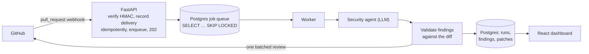

# CodeLens

AI security review for GitHub pull requests, posted as validated inline comments, with a dashboard and a measured evaluation harness.

## Live demo

**https://codelens-blue.vercel.app**: the dashboard is behind GitHub sign-in.

This is a demo for public repositories. The production GitHub App is set to install only on the owner's account, and the diff of every reviewed PR is sent to the LLM provider. The API runs on a free Render instance that sleeps when idle, so the first load can take about a minute.

## How it works



1. GitHub sends a signed `pull_request` webhook. The API checks the HMAC, records the delivery ID (a redelivery is a no-op), queues a job and answers `202` within the request. No AI work happens in the request.
2. A worker claims the job from a Postgres table (`FOR UPDATE SKIP LOCKED`), fetches the PR's files with an installation token and drops noise (lockfiles, vendored, generated, binary and very large files).
3. The security agent reviews the diff and returns schema-validated findings. Each one is checked against the diff before anything is posted.
4. One review (inline comments plus an AI-generated summary) is posted to the PR. The run, its findings, the token usage and the estimated cost are stored, and the dashboard shows them.

## Features

- **GitHub App intake:** signed webhooks (HMAC-SHA256, constant-time compare). Intake is idempotent on `X-GitHub-Delivery`, and a new push supersedes the PR's older queued or running review.
- **Postgres-backed job queue:** retries with exponential backoff and a cap on attempts. Jobs from a worker that died go back to the queue after a visibility timeout. On shutdown, running jobs get a grace period and are then released. The worker runs as its own process or inside the API process.
- **LLM security review:** Groq `openai/gpt-oss-120b` by default, behind a provider interface that also has a Gemini implementation and a fake for tests.
  - Structured output, with a bounded retry when the answer doesn't match the schema.
  - Versioned prompt files, and every run records its prompt version.
  - Prompt-injection defences: the diff sits between delimiters that contain a random token, it is treated as data only, and the model's output is never trusted.
- **Finding validation:**
  - A comment's line must be inside the diff, and the cited lines must include a changed (added) line.
  - The quoted evidence must appear on those lines.
  - Duplicates are removed, a confidence threshold applies, and there is a cap on comments.
  - The review is always posted as a comment: it never approves or blocks a PR.
- **Sign-in and access control:**
  - GitHub OAuth, then our own short-lived JWT in httpOnly cookies.
  - Refresh tokens are stored hashed and rotated on every use. Reusing an old one revokes the whole session family.
  - CSRF protection and CORS locked to the web origin.
  - Roles (owner/admin/member) per installation, plus per-repository access synced from GitHub.
- **React dashboard:** repositories and their PRs, and a review page that shows each finding under the diff line it points at, with Useful / Not useful feedback. Admins also get analytics (runs, estimated cost and acceptance rate per day) and per-repository settings (security agent on or off, severity threshold, ignored paths).
- **Daily cost cap:** reviews are skipped once the day's estimated LLM spend reaches `DAILY_COST_CAP_USD`.
- **CI/CD (GitHub Actions):**
  - Lint, type checks, tests and a build for the API and the web app on every PR.
  - The deploy runs only after CI passes on `main`, then smoke-tests that the new commit is live with a healthy database.
- **Deployment:** Vercel (web) and Render (API with the in-process worker, Docker, non-root), with Supabase Postgres. Migrations run at startup under a Postgres advisory lock, so two instances can't apply the same migration at once.

## Evaluation

A harness (`evals/`) runs the same review code the worker uses over labelled pull requests. It matches findings to labels by file, line (±2) and category, and reports precision, recall and F1 with 95% Wilson intervals, false positives on clean PRs, the invalid-output rate, cost and latency. Results were recorded on 2026-10-17 with Groq `openai/gpt-oss-120b` and prompt `security_v1`, 3 repeats per case:

| | Dev | Held-out test |
| --- | --- | --- |
| Sample | 9 cases, 7 required issues | 7 cases, 5 required issues |
| Precision [95% CI] | 95.5% [60.0–99.7] | 86.7% [43.2–98.2] |
| Recall [95% CI] | 100% [64.6–100] | 86.7% [43.2–98.2] |
| F1 | 97.7% | 86.7% |
| False positives per clean case | 0.083 | 0 |
| Invalid structured outputs | 0 of 24 calls | 0 of 21 calls |
| Estimated cost per case | $0.000385 | $0.000426 |

Read these with their caveats:

- The data is synthetic and the samples are tiny, so the intervals are wide and overlap.
- 9 of the 16 cases were drafted by a model and reviewed by another model session before the owner accepted them. Nothing was labelled independently by a human.
- The whole test shortfall comes from one case: the model found a missing authorization check every time, but cited a line outside the ±2 tolerance in 2 of 3 repeats.

Method, provenance and full results: [docs/evals.md](docs/evals.md).

## Tech stack

| Area | Used |
| --- | --- |
| API | Python 3.12, FastAPI, Pydantic v2, pydantic-settings, SQLAlchemy 2 (async) + asyncpg, Alembic, httpx, PyJWT + cryptography |
| LLM | Groq SDK (`openai/gpt-oss-120b`), Google GenAI SDK (Gemini), own provider interface and client-side rate limiter |
| Database | PostgreSQL (17 locally in Docker; Supabase in production) |
| Web | React 19, TypeScript, Vite, React Router, TanStack Query, Tailwind CSS, lucide-react, API types generated from the OpenAPI schema (openapi-typescript) |
| Quality | uv, Ruff, mypy (strict on core modules), pytest + pytest-asyncio + respx, ESLint, Prettier, Vitest + Testing Library |
| Ops | Docker / docker compose, GitHub Actions, Vercel, Render, Supabase; Sentry SDK wired in with scrubbing but switched off |

## Security highlights

- **Webhooks:** constant-time HMAC check on the raw body, rejected with `401` on mismatch, and idempotent on the delivery ID.
- **Two separate auth systems:**
  - Users: GitHub OAuth, then our own JWT in cookies.
  - The worker: the App's private key, then an App JWT, then a short-lived installation token.
  - No GitHub token is stored in the database.
- **Cookies:** `HttpOnly`, `SameSite=Lax`, and `Secure` outside development and test. Requests that change state need a custom header and a matching `Origin`. CORS allows only the web origin.
- **Sessions:** refresh tokens are random and stored only as hashes. They are rotated on every use, and reuse revokes the family. A session lasts at most 7 days by default; refreshing never extends it.
- **Authorization:** every repository-scoped endpoint checks both the installation role and per-repository access.
- **Untrusted model output:**
  - The diff is wrapped in delimiters containing a random token.
  - The output is validated against a schema and against the diff.
  - Unknown fields are ignored, `@mentions` are defused, and the review event is fixed to `COMMENT`.
- **Abuse and cost:** a per-IP rate limit on `/auth/*` and the daily LLM cost cap.
- **Secrets:** environment variables only. The app refuses to start with short or placeholder secrets.
- **Least privilege:** the GitHub App asks only for Contents (read), Metadata (read) and Pull requests (read/write), and the container runs as a non-root user.

## Run it locally

You need Docker Desktop. To run migrations and tests outside Docker you also need [uv](https://docs.astral.sh/uv/) and Node 22+.

1. **Create a GitHub App of your own** (GitHub → Settings → Developer settings → GitHub Apps → New):
   - Callback URL: `http://localhost:5173/api/auth/github/callback`
   - Organization permission: Members (read-only)
   - Repository permissions: Contents (read), Metadata (read), Pull requests (read and write)
   - Webhook secret: the same value as `GITHUB_WEBHOOK_SECRET` in `.env`; subscribe to Pull request events
2. **Configure and start:**

   ```bash
   git clone https://github.com/GOPIKA-BTECH23/codelens.git && cd codelens
   cp .env.example .env
   # In .env, set JWT_SECRET and GITHUB_WEBHOOK_SECRET (openssl rand -hex 32), plus
   # GITHUB_OAUTH_CLIENT_ID and GITHUB_OAUTH_CLIENT_SECRET from the App.
   # For the worker, also set GITHUB_APP_PRIVATE_KEY (base64 of the .pem) and GROQ_API_KEY.
   docker compose up --build
   cd apps/api && uv run alembic upgrade head   # first run: create the schema
   ```

   The API and docker compose refuse to start without the secrets. The worker also needs the App key and the LLM key.
3. **If port 5432 is taken:** set `POSTGRES_PORT` (e.g. `54329`) in `.env` and use the same port in `DATABASE_URL` there.
4. **Open the app** at http://localhost:5173. Always go through this address, so the session cookies work. Other addresses:
   - API docs: http://localhost:8000/docs
   - Health check: http://localhost:8000/health
   - Worker logs: `docker compose logs -f worker`
5. **Receive webhooks locally:** run `ngrok http 8000` and set the App's webhook URL to `https://<your-ngrok-domain>/webhooks/github`. Or replay a signed sample:

   ```bash
   cd apps/api && uv run python -m scripts.replay_webhook tests/fixtures/webhooks/pull_request.opened.json
   ```

Checks (the API tests need `docker compose up -d postgres`):

```bash
cd apps/api && uv sync && uv run ruff check . ../../evals && uv run mypy && uv run pytest
cd apps/web && npm ci && npm run lint && npm run typecheck && npm test && npm run build
uv run --project apps/api python -m evals.run_evals --provider fake --split all --include-test  # eval smoke run from the repo root, no key needed
```

## Repository layout

```
apps/api/     FastAPI app (api/, core/, db/, services/, ai/, worker/), migrations/, tests/, scripts/
apps/web/     React app (src/pages, src/components, src/api)
evals/        eval harness, labelled dataset, committed results
docs/         ADRs, deployment guide, eval write-up, learning notes
infra/        render.yaml, Postgres init scripts
.github/      CI, deploy and eval workflows
```

## Documentation

- [Deployment guide](docs/deployment.md): services, environment variables, rollback, free-tier limits
- [Evaluation](docs/evals.md): matching rule, metrics, results and their limits
- Architecture decisions:
  - [ADR 0001: Database schema](docs/adr/0001-database-schema.md)
  - [ADR 0002: Session cookies, same-site proxy and CSRF](docs/adr/0002-cookie-and-csrf-strategy.md)
  - [ADR 0003: Webhook intake and GitHub App auth](docs/adr/0003-webhook-intake-and-github-client.md)
  - [ADR 0004: Worker design and deployment modes](docs/adr/0004-worker-deployment-modes.md)
  - [ADR 0005: LLM layer and review posting](docs/adr/0005-llm-layer-and-review-posting.md)
  - [ADR 0006: Dashboard API and stored patches](docs/adr/0006-dashboard-api-and-stored-patches.md)
- Learning notes:
  - [Foundation](docs/learning/M0-foundation.md)
  - [Database](docs/learning/M1-database.md)
  - [Auth](docs/learning/M2-auth.md)
  - [GitHub App](docs/learning/M3-github-app.md)
  - [Worker](docs/learning/M4-worker.md)
  - [LLM and first agent](docs/learning/M5-llm-and-first-agent.md)
  - [Dashboard](docs/learning/M6-frontend-and-rest.md)
  - [Deployment](docs/learning/M7-deployment.md)
  - [Evaluation harness](docs/learning/M13-evals.md)

## Limitations

- **Public repositories only.** Reviewed diffs go to the LLM provider, and the production App installs only on the owner's account.
- **Free-tier servers sleep** after 15 minutes idle. The first request can take about a minute, and a webhook that arrives while the API is asleep can be lost (GitHub does not redeliver automatically; it can be redelivered by hand).
- **One reviewer:** a single security agent.
- **Small eval set:** a small, synthetic evaluation set (see above).
- **Stored code isn't purged automatically yet.** Review patches and finding text are stored. The retention rules (purge on uninstall, and purge stored patches 30 days after a PR is closed or merged) are documented in ADR 0001 and ADR 0006, but the purge job is not implemented, so the rules are not enforced yet.

## License

MIT, see [LICENSE](LICENSE).
