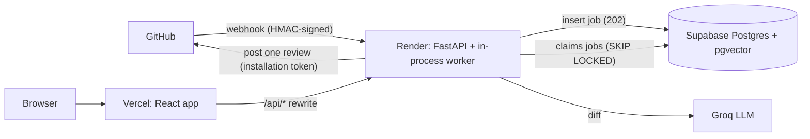

# CodeLens

AI security review for GitHub pull requests. Findings are checked against the changed lines and posted as inline review comments, with a dashboard to browse and rate them and an evaluation harness that measures review quality. Chat with your repo is planned (M9) and not built yet.

> **Status: under construction.** Done so far:
>
> - **The core product, deployed (M0 to M7):** sign-in, webhook intake, the job worker, a first security agent that reviews PRs and posts inline comments, a dashboard, and a live deployment.
> - **An evaluation harness (M13):** it scores the security agent on a small labelled set of synthetic PRs. The results and their limits are in [docs/evals.md](docs/evals.md).
>
> Not built yet:
>
> - repo indexing and chat (M8, M9);
> - the multi-agent review pipeline (M10);
> - the observability and cost-control milestone (M11);
> - test hardening (M12);
> - the security hardening review (M14).
>
> See the checklist below.

## Live demo

- **App:** https://codelens-blue.vercel.app
- **Demo repository (install the GitHub App here, open a PR):** `https://github.com/GOPIKA-BTECH23/<demo-repo>` _(set after you create it)_
- **First load may take about a minute.** The API runs on a free Render instance that sleeps after 15 minutes without traffic. Reviews can also be delayed if a webhook arrives while it sleeps; the demo is for public or demo repositories only (every reviewed diff is sent to the LLM provider).

**What has been verified on the live deployment** (2026-10-17, details in [ADR 0002](docs/adr/0002-cookie-and-csrf-strategy.md)): `/api/health` reports database ok and is not cached; the OAuth cookie is set HttpOnly, Secure, SameSite=Lax through the Vercel rewrite; a test stream through the rewrite arrived event by event (SSE is not buffered). A full sign-in and a real PR review were also tested manually. Not yet verified: the real chat stream (M9), since chat does not exist yet.

Hosting: Vercel (web) · Render (API + worker in one free service) · Supabase (Postgres + pgvector) · GitHub Actions (CI, then a gated deploy with a smoke test).

## Architecture



The design is described in [CLAUDE.md](CLAUDE.md), section 4. Deploying it: [docs/deployment.md](docs/deployment.md).

In one line: GitHub webhook → FastAPI (verify, record, enqueue, return `202`) → Postgres job queue → worker (a single security agent behind the `ReviewAgents` pipeline interface, findings validated against the diff) → one review posted on the PR. A React dashboard sits on top. The LangGraph multi-agent pipeline (M10) and repo indexing and chat (M8, M9) are planned, not built.

## Quickstart (local)

Requirements: Docker Desktop. For running tests outside Docker you also need Node 22+ and [uv](https://docs.astral.sh/uv/).

```bash
git clone https://github.com/GOPIKA-BTECH23/codelens.git
cd codelens
cp .env.example .env   # local settings; gitignored
# edit .env: JWT_SECRET, GITHUB_OAUTH_CLIENT_ID, GITHUB_OAUTH_CLIENT_SECRET, GITHUB_WEBHOOK_SECRET,
#           GITHUB_APP_PRIVATE_KEY and GROQ_API_KEY (see below)
docker compose up --build
```

Sign-in needs a GitHub App of your own (free, a few minutes): GitHub → Settings → Developer settings → GitHub Apps → New. Set the **callback URL** to `http://localhost:5173/api/auth/github/callback`, give it **Organization permissions → Members: Read-only**, then put its Client ID and a client secret in `.env`. Generate `JWT_SECRET` and `GITHUB_WEBHOOK_SECRET` with `openssl rand -hex 32` (the webhook secret must also be pasted into the App's settings). The API refuses to start without these.

Then open:

| What                 | URL                                |
| -------------------- | ---------------------------------- |
| Web app (sign in)    | http://localhost:5173              |
| API status page      | http://localhost:5173/health       |
| API health           | http://localhost:8000/health       |
| API readiness        | http://localhost:8000/ready        |
| API docs (Swagger)   | http://localhost:8000/docs         |
| Postgres + pgvector  | `localhost:5432`                   |

Always use the app through `http://localhost:5173`: the browser reaches the API at `/api/*` on the same origin, which is what makes the httpOnly session cookies work ([ADR 0002](docs/adr/0002-cookie-and-csrf-strategy.md)). See [.env.example](.env.example) for every variable.

Set up the database (the API container does not migrate for you yet):

```bash
cd apps/api
uv run alembic upgrade head                 # create the schema
ENVIRONMENT=development uv run python -m scripts.seed   # optional: fake dev data
```

If port 5432 is already used on your machine, set `POSTGRES_PORT` (for example `54329`) in the root `.env`, restart Postgres (`docker compose up -d postgres`), and use the same port in that file's `DATABASE_URL`.

### The worker

`docker compose up` also starts a `worker` service (`python -m app.worker.main`) that claims jobs from the Postgres queue. Follow it with `docker compose logs -f worker`; every line carries the `job_id` (and `run_id` for reviews).

The worker needs `GITHUB_APP_PRIVATE_KEY` (base64 form for Docker, see [.env.example](.env.example)) and the key of the chosen LLM provider (`LLM_PROVIDER=groq` by default, so `GROQ_API_KEY`), and refuses to start without them. `index_repo` is still a stub (M8), and uninstall `purge_installation` jobs have no handler yet and end up `dead` on purpose ([ADR 0004](docs/adr/0004-worker-deployment-modes.md)).

### What a review does

For each `pull_request` opened/synchronize/reopened event the worker fetches the PR's files, drops noise (lockfiles, vendored, minified, generated, binary, very large files), sends the remaining diff to the security agent, keeps only findings that point at real changed lines with evidence from the diff, and posts **one** review: inline comments plus a summary that says it is AI-generated and may be wrong. Docs-only PRs are skipped by default (`REVIEW_NO_CODE_BEHAVIOR`). Every run records tokens, estimated cost at list price, latency and the prompt version. Details: [ADR 0005](docs/adr/0005-llm-layer-and-review-posting.md).

**Privacy:** the diff of every reviewed PR is sent to the configured LLM provider. Use CodeLens on public or demo repositories. Gemini requests are sent with `store=false`; note that free tiers of LLM providers may use requests to improve their products.

| Mode | How | Good for | Trade-offs |
| ---- | --- | -------- | ---------- |
| Separate process | `python -m app.worker.main` or the compose `worker` service | local dev, any paid host | API and worker restart, scale and fail independently; needs a second process (Render's free tier has no free worker) |
| In the API process | `RUN_WORKER_IN_API=true` | free-tier demo with one service | shares RAM (512 MB) and the event loop with web traffic; a deploy or sleep stops both; cannot scale them apart |

### Receiving GitHub webhooks locally

GitHub must reach `POST /webhooks/github` on the API (port **8000**, not the web app). Use [ngrok](https://ngrok.com/) (a free account includes one dev domain):

```bash
ngrok http 8000
# copy the https://<your-dev-domain>.ngrok-free.app "Forwarding" URL, then in the GitHub App
# settings set Webhook URL = https://<your-dev-domain>.ngrok-free.app/webhooks/github
```

Use ngrok rather than smee.io: smee re-serialises the JSON body, which can change its bytes and break the signature check ([ADR 0003](docs/adr/0003-webhook-intake-and-github-client.md)). Without a tunnel, replay a saved, correctly signed payload:

```bash
cd apps/api
uv run python -m scripts.replay_webhook tests/fixtures/webhooks/pull_request.opened.json
```

Run the checks without Docker (the API tests need `docker compose up -d postgres`):

```bash
cd apps/api && uv sync && uv run ruff check . && uv run mypy && uv run pytest
cd apps/web && npm ci && npm run lint && npm run typecheck && npm test && npm run build
```

## Milestones

- [x] M0 Foundation and monorepo scaffolding
- [x] M1 Database layer
- [x] M2 Authentication, sessions and RBAC
- [x] M3 GitHub App integration and webhook intake
- [x] M4 Worker and job processing
- [x] M5 LLM layer and the first agent
- [x] M6 Frontend dashboard and review pages
- [x] M7 Deploy the MVP (live at https://codelens-blue.vercel.app)
- [ ] M8 Repo indexing
- [ ] M9 Hybrid retrieval and streaming repo chat
- [ ] M10 LangGraph multi-agent review pipeline
- [ ] M11 Observability, cost control and rate limiting
- [ ] M12 Testing hardening and CI quality gates
- [x] M13 Evaluation harness
- [ ] M14 Security hardening review
- [ ] M15 Polish: docs, demo, résumé

## License

MIT, see [LICENSE](LICENSE).
