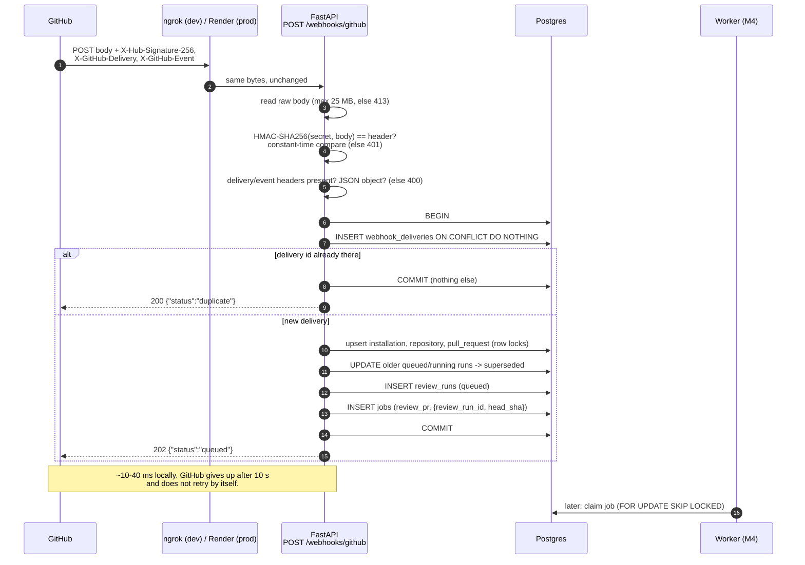

# M3: GitHub App integration and webhook intake

## What was built

- **App authentication** (`app/services/github_app.py`):
  - loads the App's private key from a file path, base64 PEM or PEM text;
  - signs a short RS256 **app JWT**;
  - exchanges it for **installation access tokens**, cached in memory until 5 minutes before they expire (one fetch per installation, even under concurrency).
- **REST client** (`app/services/github_client.py`): PR details, unified diff, PR files, file contents at a ref, streamed tarball download, one batched PR review, and an issue comment. It handles rate limits (`retry-after`, `x-ratelimit-*`), backoff on 5xx, `Link` pagination, and a 401 → new token → retry once.
- **Webhook endpoint** `POST /webhooks/github` (`app/api/webhooks.py`, `app/services/webhooks.py`):
  - verifies `X-Hub-Signature-256` over the raw body;
  - records `X-GitHub-Delivery` idempotently;
  - creates rows and jobs per event:
    - `pull_request` → a `review_run` (queued) and a `review_pr` job, superseding older runs;
    - `push` to the default branch → an `index_repo` job;
    - `installation` / `installation_repositories` → installation and repository upserts, uninstall marking, access removal.
  - Drafts and configured bot authors are skipped.
- **Signature check** (`app/core/webhook_signature.py`), tested against GitHub's published test vector.
- **Shared upserts** (`app/services/github_sync.py`): login (M2) and webhooks write installations and repos the same way.
- **Dev tooling**:
  - `scripts/replay_webhook.py` signs and sends a saved payload;
  - `tests/fixtures/webhooks/` holds redacted real payloads.
- **Config**:
  - `GITHUB_WEBHOOK_SECRET` is required;
  - `GITHUB_APP_PRIVATE_KEY` is optional until M4, parsed at startup when set;
  - `WEBHOOK_IGNORED_PR_AUTHORS` is new;
  - `GITHUB_APP_ID` is removed, because the JWT issuer is the client ID.
- **ADR 0003**: intake design, retry policy, ngrok vs smee.
- **Tests**: 286 API tests in total (164 unit, 122 integration on real Postgres, GitHub mocked with respx). Four checks were deliberately broken once to prove the tests notice:
  - signature check always true → 8 failures;
  - superseding removed → 2 failures;
  - token cache ignores expiry → 1 failure;
  - POST retried on 5xx → 1 failure.

## Webhook intake, step by step

In plain words: the endpoint is a **bouncer and a receptionist**, not a worker. It checks the caller is really GitHub, writes down "this delivery arrived" plus what needs doing, and hangs up. Everything slow (installation token, diff, LLM, posting the review) happens later in the worker, which reads the `jobs` table. The webhook code does not even import the GitHub client.

## Three kinds of GitHub credentials

| | OAuth App | GitHub App (as itself) | Installation token |
| --- | --- | --- | --- |
| What it is | A separate kind of GitHub app. It acts **as a user** with OAuth scopes. | Our App, proven with a **JWT signed by its private key**. | A token the App gets **for one installation** (one account's selected repos). |
| How you get it | User consents; you exchange a code for a token. | Sign `{iat, exp, iss}` with RS256 yourself. No network call. | `POST /app/installations/{id}/access_tokens` with the JWT. |
| Lifetime | Long-lived until revoked. | At most 10 minutes (we use 9). | 1 hour. |
| Acts as | The user, with everything their scopes allow, in every repo they can reach. | The App, but only on `/app/...` endpoints (e.g. mint tokens). | The App's bot (`codelens[bot]`), limited to the permissions the App was granted and the repos the owner selected. |
| Where we use it | Not at all. | Only to mint installation tokens (worker). | Every repo call the worker makes (diff, files, posting reviews). |

There is a fourth credential from M2: the **user access token of the GitHub App** (the login flow). It proves who a person is, lives one local variable long, and is revoked right after login. CodeLens never acts as the user.

Why a GitHub App and not an OAuth App?
- **Least privilege:** fine-grained permissions (Pull requests: write, Contents: read) instead of broad scopes like `repo`.
- **Limited reach:** only the repos the owner picked.
- **Honest authorship:** reviews come from `codelens[bot]` rather than impersonating a person.
- **Short-lived tokens:** a leaked installation token is useless within an hour.
- **Webhooks built in.**

## Why verify the HMAC over the raw body

GitHub computes `HMAC-SHA256(secret, exact bytes it sent)`. The signature covers **bytes, not meaning**:

- `{"a":1}` and `{"a": 1}` are the same JSON but different bytes, so they have different HMACs.
- If we parsed the JSON first and then re-serialised it to check, key order, whitespace, number formatting and Unicode escaping (`é` vs `é`) could all differ, and valid deliveries would fail.
- Worse, a "parse then verify" design tempts you to act on the parsed data before the check finishes.

So the route reads the raw body, verifies, and only then calls `json.loads`. The same reasoning is why smee is a bad tunnel here: it parses and re-serialises the JSON before forwarding. ngrok passes the bytes through untouched.

**Constant time:** `==` on strings stops at the first differing character, so an attacker timing many requests could learn the right signature one character at a time. `hmac.compare_digest` takes the same time wherever the difference is. **Secret strength:** an HMAC is only as good as its secret, so short and placeholder secrets are refused at startup.

The signature proves who sent a request; it does not stop a replay. Someone who captured a delivery could resend the exact same bytes, and the signature would still be valid. What stops a replay is the next section: the delivery ID is already recorded, so the copy is a no-op.

## Idempotency, and why deliveries arrive more than once

**Idempotent** means doing it twice has the same effect as doing it once. Our endpoint is idempotent per `X-GitHub-Delivery`. The second time, the INSERT conflicts on the UNIQUE column, we answer 200 and do nothing else: no second run, no second job.

Why would the same delivery arrive twice? GitHub (checked 2026-10-16) **does not automatically redeliver** failed deliveries, but copies still happen:

1. **Manual redelivery.** Someone clicks "Redeliver" in the App's *Recent Deliveries*, or a recovery script calls the redeliver API after downtime. The copy keeps the **same delivery ID**.
2. **Lost responses.** We commit, then the connection drops (or we are slower than 10 s). GitHub records a failure even though we processed it, and a later redelivery brings it back.
3. **Replays.** An attacker resends a captured delivery. The signature is still valid, but the ID is already used.

Webhooks are therefore **at-least-once**, and the receiver must deduplicate. The opposite failure matters too. If our handler crashes **after** inserting the delivery row but **before** enqueuing the job, a redelivery would be treated as a duplicate and the work lost forever. That is why the delivery row, the PR/run rows and the job are written in **one transaction**: either all of them exist or none do (a test proves a malformed payload leaves no row, so the fixed redelivery succeeds). This is the concrete argument for a Postgres queue in ADR 0001, because a Redis queue could not join that transaction.

## Superseding and the race it avoids

A new push to a PR makes earlier reviews stale. When a review-triggering event arrives, we mark that PR's `queued`/`running` runs `superseded` and queue a new one. A running review is not killed. Its worker re-checks the status before posting (decision 16) and drops the result.

The race: `opened` and `synchronize` for the same PR arrive at the same time. Each transaction supersedes "older runs" and inserts its own, but neither can see the other's uncommitted run, so both could stay `queued`. The fix is the upsert itself. `INSERT ... ON CONFLICT DO UPDATE` **locks the row** until commit, so the second transaction waits. Postgres's default READ COMMITTED isolation gives each new statement a fresh snapshot, so once it continues it sees the first run and supersedes it. `test_webhook_concurrency.py` proves the wait happens.

Known limit (ADR 0003): the run created *last* wins, which could be an older commit if GitHub delivers out of order.

## Other decisions, briefly

- **202 vs 200:** 202 = "accepted, work queued (or deliberately ignored)"; 200 = "already had it". GitHub treats both as success.
- **Body cap before verification:** reading an unauthenticated body is itself a risk, so we stop at 25 MB, GitHub's own payload cap.
- **Missing `default_branch`:** installation payloads omit it. We store the column default and let the next PR or push payload correct it, instead of calling the API from the webhook. The push filter uses the payload's value, so it is never misled.
- **POSTs are not retried on 5xx:** GitHub might have created the review already, and a duplicate review on someone's PR is worse than a failed job. Rate-limit answers *are* retried, because GitHub rejected those requests without acting.
- **Long rate-limit waits go back to the queue** (`GitHubRateLimited(retry_at)`) instead of parking a worker for 30 minutes.
- **Token cache is a dict:** losing it on restart costs one HTTP call per installation, so Redis would add a service for nothing.
- **JWT issuer = client ID:** GitHub's recommendation. We already had the client ID from M2, so `GITHUB_APP_ID` disappeared.

## 5 likely interview questions

1. **Why must the webhook handler return quickly, and how do you guarantee it?** GitHub waits 10 s and does not retry on its own, so a slow handler means lost events. Ours only verifies, writes a few rows and enqueues a job in one transaction (about 10–40 ms locally). All GitHub and LLM calls happen in the worker, and the webhook module does not import the GitHub client.
2. **Why compare signatures in constant time, and over the raw body?** `==` leaks how many leading characters matched, which allows a timing attack. The HMAC covers exact bytes, and parsing then re-serialising JSON changes bytes, so we verify before parsing.
3. **What makes intake idempotent, and what breaks if the delivery insert and the job insert are in different transactions?** The UNIQUE `delivery_id` with `ON CONFLICT DO NOTHING`. With separate transactions, a crash between them leaves "seen but no job". The redelivery is then treated as a duplicate and the review never happens.
4. **GitHub App vs OAuth App vs installation token?** An OAuth App acts as a user with broad scopes. A GitHub App authenticates as itself with a private-key-signed JWT (10 minutes max), which can only mint installation tokens: 1-hour tokens limited to the App's permissions and the repos that owner selected. Least privilege, bot identity, short-lived credentials.
5. **Why not retry every failed request?** Reads are safe to repeat. Creating a review is not: after a 502 you do not know whether it happened, and a retry could double-post. Rate-limit responses are safe to retry because GitHub did not process the request, and we follow its wait order (`retry-after` → reset time → 60 s, growing).

## Things to try breaking

- Change one byte of a fixture after signing it (`--bad-signature`, or edit the file between two replays) → 401, no rows.
- Replay the same file twice with `--delivery-id demo-1` → 202, then 200 `duplicate`, one run.
- In `webhook_signature.py`, replace `hmac.compare_digest(...)` with `==`. Tests still pass, which shows constant-time behaviour cannot be unit-tested here. It is a code-review item.
- Remove `_supersede_active_runs` → `test_new_push_supersedes...` and the concurrency test fail.
- Replace the PR upsert with a plain `SELECT`, then `INSERT` if missing (no row lock), and run `test_webhook_concurrency.py`: the second transaction no longer waits.
- Set `TOKEN_REFRESH_MARGIN` to 0 and see `test_token_is_refreshed_shortly_before_it_expires` fail. Then think about a job that starts with a token expiring in 30 s.
- Point the GitHub App at a smee.io URL and open a PR whose title contains `é`. Compare the signature results with ngrok.
